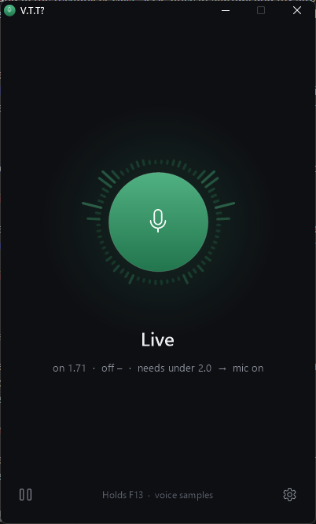
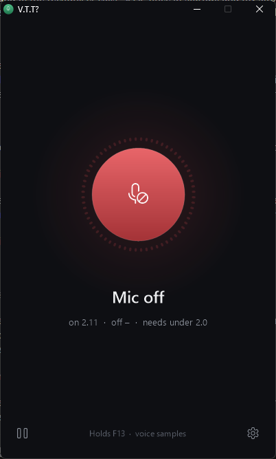
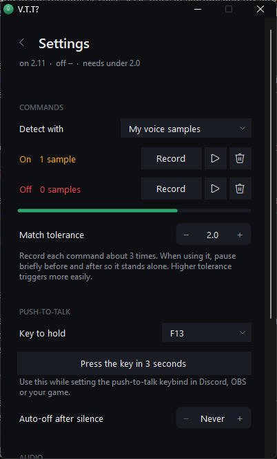

# V.T.T?

**Voice-activated push-to-talk for Windows.** Say a command and V.T.T? holds your push-to-talk key down for you; say another and it lets go. No hands, no hotkeys, no always-open mic.

<p align="center">
  
  
  
</p>

> **1.0 beta** - works, but expect rough edges. Please [open an issue](https://github.com/Shiverbolt/VTT/issues) if something misbehaves.

## Features

- **Your own voice commands** - record yourself saying anything (any language, any word, even a hum) as the ON and OFF commands. Matching is tuned to your voice, so other people and game audio rarely trigger it.
- **Or spoken phrases** - type phrases like `mic on` / `over and out` and let the built-in Windows speech recognizer listen for them.
- **Works with anything that has push-to-talk** - Discord, TeamSpeak, Mumble, OBS, games. V.T.T? simply holds the key you choose (default **F13**, a key no keyboard has, so it never clashes with typing).
- **Live voice spectrum** around an animated orb, so you can see it hearing you.
- **Pick your microphone and sound output**, optional on/off sounds, auto-off after silence, tray icon.
- **Fully offline** - audio never leaves your PC. No account, no telemetry, no installer, no dependencies (uses the .NET Framework built into Windows 10/11).

## Get started

1. Download `VTT.exe` from the [latest release](https://github.com/Shiverbolt/VTT/releases) and run it.
2. In Discord (or your app), switch to **Push to Talk** and click the keybind box.
3. In V.T.T?, open **Settings** (gear icon) and click **Press the key in 3 seconds** - your app records the key.
4. Under **Commands**, click **Record** next to *On* and say your command. Repeat about 3 times, then do the same for *Off*.
5. Close settings. Say your ON command - the orb turns green and your mic is live.

Tip: say commands on their own with a short pause before and after - V.T.T? listens for separate bursts of sound, so a command in the middle of a sentence won't count.

Click the orb to toggle manually, and the pause button to stop listening altogether.

## Tuning

After each sound in voice-sample mode, the line under the status shows how close it was to each command (e.g. `on 1.12 · off 6.40 · needs under 2.0`). Around 1 means a near-perfect repeat.

- Real commands missed? Raise **Match tolerance** or record another sample.
- Random sounds triggering it? Lower the tolerance.

## About the download (Windows SmartScreen)

`VTT.exe` is signed with a **self-signed** certificate (published as `VTT-codesign.cer` with each release), so Windows still shows *"Unknown publisher"* and SmartScreen may warn on first run (*More info → Run anyway*). The signature lets you confirm the file wasn't altered; compare its SHA-256 with `SHA256SUMS.txt` in the release:

```powershell
Get-FileHash .\VTT.exe -Algorithm SHA256
```

Some games with anti-cheat ignore simulated key presses; in those, use the game's open-mic mode and V.T.T? with your voice chat app instead.

## Where data lives

Settings and recorded samples are in `%APPDATA%\VTT` (`settings.txt` and `samples\*.wav`). Delete that folder to reset.

## Build from source

No SDK required - Windows ships the C# compiler.

```powershell
.\build.ps1             # -> dist\VTT.exe
.\tests\run-tests.ps1   # offline audio tests using synthesized speech
```

Code layout: `src/Audio.cs` (capture, spectrum, voice matching), `src/MainForm.cs` (app logic and settings), `src/Ui.cs` (theme and custom-drawn controls), `src/Program.cs` (entry point, settings, key sending).

## License

[MIT](LICENSE) © 2026 Shiverbolt
